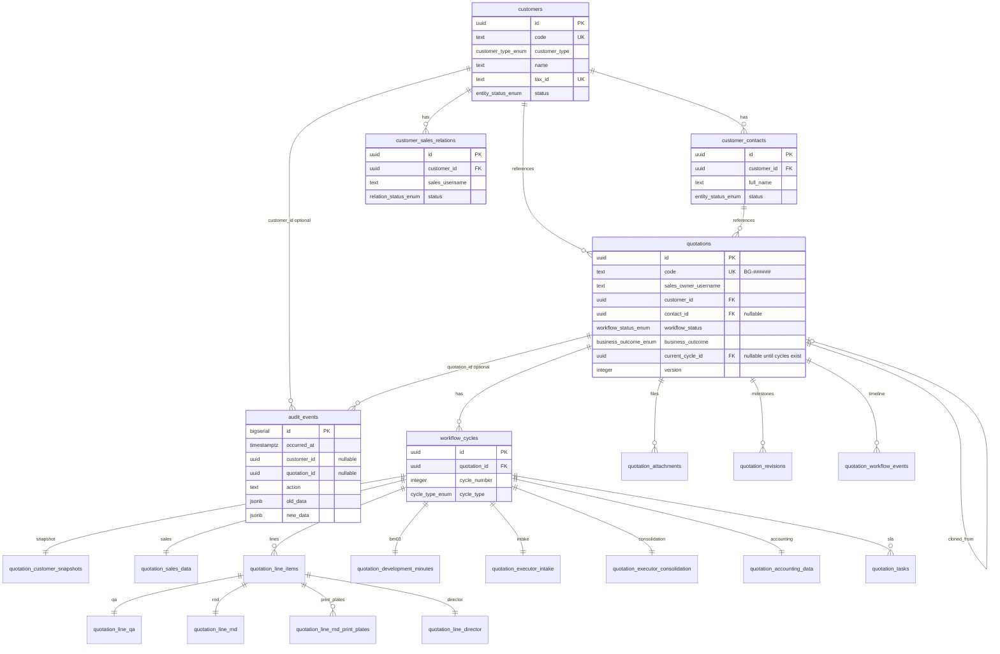

# INLA-S Database Schema (Customer + Quotation + Shared Audit)

**Status:** Authoritative for DB agent migrations. Update this file in Git when the model changes.  
**Scope:** Shared audit platform + customer domain (MVP) + quotation domain (MVP).  
**Sources:** Customer/quotation specs under `document/` (via `repo/document-index.md` and `repo/quotation-schema.md`); Workflow State Machine and SLA docx for enums and task SLA; INLA-S decisions in §1.  
**Do not** re-interpret from scattered docx when implementing migrations — use this file.

---

## 1. Product decisions (override doc OPEN items)

| Topic | Decision |
|-------|----------|
| Tax ID (MST) | **Required** for both business and individual; **UNIQUE** system-wide (`tax_id`). **CHECK** `^\d{10}$` or `^\d{13}$` (`019`, CM-O01 / CUS-04). |
| Customer display code | **`KH-` + 6 zero-padded digits** (e.g. `KH-000128`); unique; generated via DB sequence. |
| Customer / contact lifecycle | **Soft status** only (`active` / `inactive`); no hard delete in app for used data. **`quotations.customer_id` → ON DELETE RESTRICT** (CUS-012). |
| Customer ↔ Sales | **N–N** junction table; no single `sales_owner_id` on customer. |
| SALES create customer | Application **auto-inserts** junction row for creator (not a DB trigger). |
| Authorization | **Not stored in DB** — only **ADMIN** and **SALES** in app; SALES scoped by junction. Ignore multi-role CRUD matrix from doc for schema. |
| Province | **`text` column**; UI **closed list** of 63 province-level units (`frontend/src/lib/vietnamProvinces.ts`, CM-O08). **No DB master table** in MVP; province validity is enforced in the app, not a Postgres ENUM/CHECK. |
| Customer / contact phone | Stored as **`+84` + 8–11 digits** (`019` CHECK). UI normalizes on blur (`phoneVN.ts`, CM-O09 / CUS-05). |
| Company email (CUS-06) | **`customers.email` nullable** (`020`). Contact email still required on **`customer_contacts`**. **Follow-up (not DB):** `backend/customer` — `parseCreateCustomer` / partial update must not require email; map `''` → `NULL`; align `openapi.yaml`. |
| Audit | **Dedicated `audit_events` table**; row changes captured by **DB triggers**; actor from session vars set by DB client (see §5). |
| Audit in Lambda | Sub-modules **must not** insert into `audit_events` from application code except optional `audit.emit_event()` SQL for non-row events. All quotation DML that should audit uses **`runWithRequestContext`**. |
| **VER-002 Envers** | Spec mentions Hibernate Envers. INLA-S uses **Neon Postgres + Lambda**. **No Envers.** Replace with: (1) `audit_events` + `audit.capture_row_change()` on all quotation mutable tables; (2) INSERT-only **`quotation_revisions`** at Submit/Re-submit milestones (VER-006); (3) draft saves → one audit row per row UPDATE (VER-005). |
| **Quotation code (OQ-QUO-01)** | **`BG-` + 6 zero-padded digits** via `quotation_code_seq` + `next_quotation_code()` (mirror `KH-######`). |
| **revisionId (SYS-11)** | `revision_number` int per quotation + `revision_code` text (e.g. `REV-03`) for UI. |
| **Sales owner (QUO-002/003)** | `sales_owner_username text NOT NULL` — app sets from JWT; client must not set owner. |
| **Line items (QUO-008 / PRICE-FORMAT)** | **`quotation_line_items`** — ≥ 1 SKU row per `workflow_cycle`: `item_code`, `item_name`, `flute_type`, dimensions, `quantity`, Executor `unit_price`, optional `line_remark`. **`quotation_sales_data`** keeps one set per cycle of material, printing, load, and `dimension_type`, plus note and delivery fields. |
| **Per-line QA, R&D, director (`017`)** | **`quotation_line_qa`**, **`quotation_line_rnd`**, **`quotation_line_director`** are 1:1 with each line (`line_item_id` PK/FK). Cycle tables `quotation_qa_data`, `quotation_rnd_data`, and `quotation_director_data` are dropped. Accounting stays one row per cycle. |
| **Director rollup** | Application sets `quotations.workflow_status` when the director task is submitted (§6). One status per quotation. No new enum value. No trigger writes status from line decisions. |
| **Hard delete quotation** | No quotation hard delete in MVP. |
| **Money (VND)** | **`numeric(18,2)`** for all VND amounts (see §7 migration plan for rationale). |
| **OPEN field types** | `desired_delivery_time`, `production_lead_time`, `financial_adjustment` → **text**; catalog fields (`box_type`, `material`, `flute_type`) → **text** until master data. |
| **Similar quotations (SIM-*)** | Query-time only; no ranking tables in DB. |

---

## 2. ERD



**Denormalize `quotation_id`** on every quotation child table (including `workflow_cycles`) so audit triggers avoid hot-path joins.

---

## 3. Enums

Create Postgres enums (names fixed until renamed in a later migration):

### Customer (migration `003`)

| Enum | Values |
|------|--------|
| `customer_type_enum` | `business`, `individual` |
| `entity_status_enum` | `active`, `inactive` |
| `relation_status_enum` | `active`, `inactive` |

### Quotation (migration `007`)

| Enum | Values | Source |
|------|--------|--------|
| `workflow_status_enum` | `draft`, `cancelled`, `executor_intake`, **`qa_rnd_review`**, `executor_consolidation`, `accounting_review`, `director_review`, `approved`, `rejected` | **Workflow State Machine §4** — single gate while QA and R&D run in parallel (not separate `qa_review` / `rnd_review` workflow statuses). |
| `business_outcome_enum` | `not_updated`, `sent_to_customer`, `won`, `lost` | SYS-04; meaningful when `workflow_status = approved`. |
| `cycle_type_enum` | `new`, `re_submit` | SYS-05 |
| `task_type_enum` | `executor_intake`, `qa_review`, `rnd_review`, `executor_consolidation`, `accounting_review`, `director_review` | SLA / permission matrix — **two tasks** under `qa_rnd_review`. |
| `task_status_enum` | `pending`, `in_progress`, `completed` | State machine §5 |
| `dimension_type_enum` | `inner`, `outer` | SAL-14 |
| `sla_alert_state_enum` | `normal`, `warning`, `overdue` | SLA spec §10.1 |
| `director_decision_enum` | `approved`, `rejected` | DIR-01 |
| `attachment_section_enum` | `sales`, `qa`, `rnd`, `executor_intake`, `executor_consolidation`, `accounting` | ATT-08/09 |
| `workflow_action_type_enum` | `submit`, `cancel`, `task_start`, `task_complete`, `approve`, `reject`, `outcome_update`, `resubmit_open`, `clone` | HIS-06 |
| `ink_coverage_band_enum` | `le_30`, `le_50`, `le_70`, `le_100` | BM02 LIN-24 (`022`) |

Use `snake_case` labels in Postgres; map to camelCase in API.

---

## 4. Tables (columns & constraints)

### 4.1 `customers`

| Column | Type | Constraints | Notes |
|--------|------|-------------|-------|
| `id` | `uuid` | PK, default `gen_random_uuid()` | Internal PK |
| `code` | `text` | NOT NULL, UNIQUE | From `customer_code_seq` via `next_customer_code()`: `KH-` + 6 digits. Past 999999 the suffix is not truncated. |
| `customer_type` | `customer_type_enum` | NOT NULL | CUS-01 |
| `name` | `text` | NOT NULL | CUS-02; trim in app |
| `short_name` | `text` | NULL | CUS-03 |
| `tax_id` | `text` | NOT NULL, UNIQUE | CUS-04; MST. **CHECK** 10 or 13 digits (`customers_tax_id_mvp_chk`, `019`). |
| `phone` | `text` | NOT NULL | CUS-05. **CHECK** `^\+84\d{8,11}$` (`customers_phone_mvp_chk`, `019`). |
| `email` | `text` | NULL | CUS-06 **optional** at customer level (`020`). When present, app validates format; store **`NULL`** not `''` (Lambda maps empty string → NULL). Not `citext`. **`customer_contacts.email` remains NOT NULL.** |
| `address_line` | `text` | NOT NULL | CUS-07 |
| `province` | `text` | NOT NULL | CUS-08; value from UI closed list (§1 Province); not validated in DB. |
| `website` | `text` | NULL | CUS-09 |
| `notes` | `text` | NULL | CUS-10 |
| `status` | `entity_status_enum` | NOT NULL, default `active` | CUS-11 |
| `created_at` | `timestamptz` | NOT NULL, default `now()` | |
| `updated_at` | `timestamptz` | NOT NULL, default `now()` | bump on UPDATE (trigger or app) |
| `created_by` | `text` | NULL | Cognito username snapshot |
| `updated_by` | `text` | NULL | |

**Indexes (minimum):** UNIQUE on `code`, `tax_id`; `(status, updated_at DESC)` for admin list; `(phone)` btree (`customers_phone_idx`, `019`) for equality/prefix lookup — **not** substring `ILIKE` (see §8).

**Sequence:** `customer_code_seq` START 1 INCREMENT 1.

**Customer domain open items (UI MVP 2026-11-08 delta):**

| Open ID | Resolution |
|---------|------------|
| **CM-O01** | **Closed (DB):** `tax_id` UNIQUE (existing) + CHECK 10/13 digits (`019`). |
| **CM-O08** | **Closed (UI):** province combobox; DB remains `text` without master table. |
| **CM-O09** | **Closed (DB + UI):** phone `+84…` CHECK on `customers` and `customer_contacts` (`019`); MST CHECK as above. |

---

### 4.2 `customer_contacts`

| Column | Type | Constraints | Notes |
|--------|------|-------------|-------|
| `id` | `uuid` | PK, default `gen_random_uuid()` | |
| `customer_id` | `uuid` | NOT NULL, FK → `customers(id)` ON DELETE RESTRICT | CON-09 |
| `full_name` | `text` | NOT NULL | CON-01 |
| `job_title` | `text` | NULL | CON-02 |
| `department` | `text` | NULL | CON-03 |
| `email` | `text` | NOT NULL | CON-04; required when creating/editing a contact (unchanged by `020`). |
| `phone` | `text` | NOT NULL | CON-05. **CHECK** `^\+84\d{8,11}$` (`customer_contacts_phone_mvp_chk`, `019`). |
| `notes` | `text` | NULL | CON-06 |
| `is_primary` | `boolean` | NOT NULL, default `false` | CON-07; **at most one** `is_primary = true` **and** `status = 'active'` per `customer_id` — partial unique index `customer_contacts_one_active_primary_uniq` (`019`, CON-R01). App must clear the previous primary when promoting another. |
| `status` | `entity_status_enum` | NOT NULL, default `active` | CON-08 |
| `created_at` | `timestamptz` | NOT NULL, default `now()` | |
| `updated_at` | `timestamptz` | NOT NULL, default `now()` | |

**Indexes:** `(customer_id)`; `(customer_id, status)`; partial UNIQUE `(customer_id) WHERE is_primary AND status = 'active'`.

---

### 4.3 `customer_sales_relations`

| Column | Type | Constraints | Notes |
|--------|------|-------------|-------|
| `id` | `uuid` | PK, default `gen_random_uuid()` | |
| `customer_id` | `uuid` | NOT NULL, FK → `customers(id)` ON DELETE RESTRICT | |
| `sales_username` | `text` | NOT NULL | Lowercase email/username |
| `status` | `relation_status_enum` | NOT NULL, default `active` | |
| `created_at` | `timestamptz` | NOT NULL, default `now()` | |
| `created_by` | `text` | NULL | |
| `ended_at` | `timestamptz` | NULL | When status → inactive |
| `ended_by` | `text` | NULL | |

**Constraints:** partial unique index `(customer_id, sales_username) WHERE status = 'active'`.

**Indexes:** `(sales_username)` WHERE `status = 'active'`.

---

### 4.4 `audit_events` (shared platform)

Append-only audit log for all sub-modules.

| Column | Type | Constraints | Notes |
|--------|------|-------------|-------|
| `id` | `bigserial` | PK | |
| `occurred_at` | `timestamptz` | NOT NULL, default `now()` | |
| `actor_username` | `text` | NULL | From `current_setting('audit.actor_username', true)` |
| `actor_role` | `text` | NULL | From `audit.actor_role` |
| `request_id` | `text` | NULL | From `audit.request_id` |
| `schema_name` | `text` | NOT NULL | usually `public` |
| `table_name` | `text` | NOT NULL | |
| `operation` | `text` | NOT NULL | INSERT, UPDATE, DELETE |
| `entity_id` | `text` | NOT NULL | PK cast to text |
| `customer_id` | `uuid` | NULL | Denormalize for customer-scoped history; no FK yet. |
| `quotation_id` | `uuid` | NULL | **Added in migration `013`**; denormalize for quotation-scoped history; no FK yet. |
| `action` | `text` | NOT NULL | Semantic; see §5.3 |
| `old_data` | `jsonb` | NULL | NULL on INSERT |
| `new_data` | `jsonb` | NULL | NULL on DELETE |

**Indexes:**

- `(customer_id, occurred_at DESC)` WHERE `customer_id IS NOT NULL`
- `(quotation_id, occurred_at DESC)` WHERE `quotation_id IS NOT NULL` (**`013`**)
- `(table_name, entity_id, occurred_at DESC)`

**Retention:** no purge yet.

---

### 4.5 `quotations`

| Column | Type | Constraints | Notes |
|--------|------|-------------|-------|
| `id` | `uuid` | PK, default `gen_random_uuid()` | |
| `code` | `text` | NOT NULL, UNIQUE | SYS-01; `next_quotation_code()` |
| `sales_owner_username` | `text` | NOT NULL | SYS-02; app from JWT |
| `customer_id` | `uuid` | NOT NULL, FK → `customers(id)` ON DELETE RESTRICT | SAL-01 |
| `contact_id` | `uuid` | NULL, FK → `customer_contacts(id)` ON DELETE RESTRICT | SAL-02 |
| `cloned_from_quotation_id` | `uuid` | NULL, FK → `quotations(id)` ON DELETE RESTRICT | CLN-009 |
| `workflow_status` | `workflow_status_enum` | NOT NULL, default `draft` | SYS-03 |
| `business_outcome` | `business_outcome_enum` | NOT NULL, default `not_updated` | SYS-04 |
| `current_cycle_id` | `uuid` | NULL, FK → `workflow_cycles(id)` | added after cycles table (`009`) |
| `version` | `integer` | NOT NULL, default 1 | optimistic lock |
| `created_at` | `timestamptz` | NOT NULL, default `now()` | SYS-07 |
| `updated_at` | `timestamptz` | NOT NULL, default `now()` | SYS-09 |
| `created_by` | `text` | NULL | SYS-08 |
| `updated_by` | `text` | NULL | |
| `cancelled_at` | `timestamptz` | NULL | QUO-021/022 |
| `cancelled_by` | `text` | NULL | |

**Indexes:** UNIQUE `code`; `(sales_owner_username, updated_at DESC)`; `(customer_id, created_at DESC)`; `(workflow_status)`.

**Sequence:** `quotation_code_seq`; `next_quotation_code()` → `BG-000001` style.

---

### 4.6 `workflow_cycles`

| Column | Type | Constraints |
|--------|------|-------------|
| `id` | `uuid` | PK, default `gen_random_uuid()` |
| `quotation_id` | `uuid` | NOT NULL, FK → `quotations(id)` ON DELETE RESTRICT |
| `cycle_number` | `integer` | NOT NULL, UNIQUE `(quotation_id, cycle_number)` |
| `cycle_type` | `cycle_type_enum` | NOT NULL |
| `resubmit_reason` | `text` | NULL — required in app when `re_submit` (SAL-04, RES-005) |
| `submitted_at` | `timestamptz` | NULL |
| `submitted_by` | `text` | NULL |
| `ended_at` | `timestamptz` | NULL |
| `created_at` | `timestamptz` | NOT NULL, default `now()` |

First submit creates cycle type `new`. Re-submit creates new cycle type `re_submit` in `draft` until submit.

---

### 4.7 `quotation_customer_snapshots`

One row per `workflow_cycle_id` (UNIQUE on `workflow_cycle_id`). Filled at Submit; **no UPDATE** in app after insert.

Columns: `workflow_cycle_id`, `quotation_id`; snapshot of customer type, code, name, tax_id, phone, email, address_line, province; contact id + name, email, phone, job_title (nullable as needed); `created_at`.

---

### 4.8 `quotation_sales_data`

One row per `workflow_cycle_id` (PK/FK on `workflow_cycle_id`). SKU identity stays on **`quotation_line_items`** (§4.13.2): `item_code`, `item_name`, `flute_type`, dimensions, `quantity`, Executor `unit_price`, optional `line_remark`. This table keeps **one set per cycle** of material, printing, load, and dimension type, plus the sales header fields below. Columns from `010` that duplicate the SKU (`box_type`, `length_mm`, `width_mm`, `height_mm`, `flute_type`, `quantity_pieces`, `layer_count`) remain stored; the app writes the SKU on the line.

| Column | Type | Notes |
|--------|------|-------|
| `quotation_id` | `uuid` | denormalized |
| `customer_request_no` | `text` | SAL-07 Số …/YCBG (`022`, optional) |
| `sales_note` | `text` | SAL-03 |
| `dimension_type` | `dimension_type_enum` | SAL-14; one value per cycle |
| `material` | `text` | one value per cycle |
| `product_load_kg` | `numeric(18,2)` | load; one value per cycle |
| `printing_description` | `text` | printing; one value per cycle |
| `print_color_count`, `print_side_count` | `integer` | printing; one set per cycle |
| `delivery_location` | `text` | SAL-23 |
| `desired_delivery_time` | `text` | SAL-24 |
| `additional_requirements` | `text` | SAL-25 |
| `updated_at` | `timestamptz` | |

---

### 4.9–4.12 Cycle role payload (one row per cycle)

Each table: PK/FK `workflow_cycle_id`, denormalized `quotation_id`, **business fields only**. Task progress and SLA live **only** on `quotation_tasks` (§4.14) — no mirror columns on role tables. QA, R&D, and director business fields are **per line** (§4.13.3–4.13.5), not on these tables. There is no per-line accounting table.

| Table | Key fields |
|-------|------------|
| `quotation_executor_intake` | `intake_note` optional. Stays on the cycle, not on the line. |
| `quotation_executor_consolidation` | `delivery_terms`, `consolidation_note` only. **Removed** `unit_price_per_piece` (EXC-01 → line `unit_price`) and `production_lead_time` (EXC-04). R&D costs are read from **`quotation_line_rnd`**. |
| `quotation_accounting_data` | One row per cycle: `payment_terms`, `vat_rate` default 10, `financial_adjustment`, `final_quotation_value`, `accounting_note`. `final_quotation_value` is not recalculated from line decisions. |

**API camelCase (Backend):** line fields `lineNumber`, `itemCode`, `itemName`, `fluteType`, `lengthMm`, `widthMm`, `heightMm`, `quantity`, `unitPrice`, `lineRemark`; QA `qualityAssessmentResult`, `qualityRequirements`, `qaNote`, `burstStandard`, `compressionStandard`, `weightLimitStandard`, `kcgStandard`, `kcgQaSxProposal1`…`3`; R&D `printingPlateCost`, `dieCost`, `productionPlan`, `rndNote`.

### 4.13.1 `quotation_development_minutes` (BM03 việc B)

One row per `workflow_cycle_id` (1:1 with the cycle). Payload does not change. BM03 meeting content stays here. The BM03 quality-standard mirror reads **`quotation_line_qa`**, not a cycle-level QA row.

| Column | Type | Notes |
|--------|------|-------|
| `workflow_cycle_id` | `uuid` | PK/FK → `workflow_cycles` RESTRICT |
| `quotation_id` | `uuid` | NOT NULL, denormalized |
| `meeting_place` | `text` | BM03-M01 |
| `meeting_date` | `date` | BM03-M02 |
| `payload` | `jsonb` | NOT NULL default `{}` — meeting-only keys: `participants`, `designNotes`, `sampleBoxNotes`, `uvCoating`, `shippingNotes`, `meetingConclusion` (per `document/annex/Annex_BM03_Development_Minutes_MVP.md`). Per-line R&D technical fields and print plates live on **`quotation_line_rnd`** / **`quotation_line_rnd_print_plates`** (`018`). |
| `created_at`, `updated_at` | `timestamptz` | `touch_updated_at` on UPDATE |

Index: `quotation_development_minutes_quotation_id_idx`. Insert empty row when cycle payload rows are created (seed/app pattern).

### 4.13.2 `quotation_line_items` (PRICE-FORMAT / BM02 LIN-*)

Many rows per `workflow_cycle_id`. Submit requires ≥ 1 line (app). Ordering: `line_number` ≥ 1, UNIQUE `(workflow_cycle_id, line_number)`. **`017`** adds `UNIQUE (id, workflow_cycle_id, quotation_id)` (`quotation_line_items_id_cycle_quotation_uniq`) so per-line children can use a composite FK. Executor writes only `unit_price` on the line; `delivery_terms` and `consolidation_note` stay on `quotation_executor_consolidation`. Field map: `document/annex/BM02-field-map.md`.

| Column | Type | Notes |
|--------|------|-------|
| `id` | `uuid` | PK |
| `workflow_cycle_id`, `quotation_id` | `uuid` | FK RESTRICT; denormalized `quotation_id` |
| `line_number` | `int` | LIN-00 ordering |
| `item_code` | `text` | legacy auto SKU |
| `fg_code`, `sap_code` | `text` | LIN-01a/b (`022`) |
| `item_name` | `text` | LIN-02 NOT NULL |
| `flute_type` | `text` | LIN-03 NOT NULL |
| `length_mm`, `width_mm`, `height_mm` | `numeric(18,2)` | legacy inner mirror; CHECK > 0; app keeps in sync with `inner_*` (`022`) |
| `inner_length_mm`, `inner_width_mm`, `inner_height_mm` | `numeric(18,2)` | LIN-04i…06i; CHECK > 0 when set (`022` backfill from legacy) |
| `outer_length_mm`, `outer_width_mm`, `outer_height_mm` | `numeric(18,2)` | LIN-04o…06o; CHECK > 0 when set |
| `layer_count` | `int` | LIN-10; CHECK > 0 when set |
| `product_weight_g` | `int` | LIN-11; CHECK > 0 when set |
| `print_color_count` | `int` | LIN-12; CHECK ≥ 0 when set |
| `quantity` | `int` | LIN-08; CHECK > 0 |
| `delivery_location` | `text` | LIN-14 per line (`022`) |
| `sales_line_note` | `text` | LIN-09s (`022`) |
| `burst_with_driver_note`, `burst_without_driver_note`, `compression_strength_note`, `paper_structure_note` | `text` | Sales QA pre-fill (`022`); authoritative QA on `quotation_line_qa` |
| `units_per_bundle`, `bundles_per_pallet` | `int` | LIN-20/21; CHECK > 0 when set |
| `pallet_stack_strapped`, `pallet_stack_unstrapped`, `shrink_wrap`, `no_shrink_wrap` | `boolean` | LIN-22/23 packaging flags |
| `ink_coverage_band` | `ink_coverage_band_enum` | LIN-24 (`022`) |
| `unit_price` | `numeric(18,2)` | LIN-07 / EXC-01; EXECUTOR; NULL until consolidation |
| `line_remark` | `text` | legacy optional remark |
| `created_at`, `updated_at` | `timestamptz` | `touch_updated_at` on UPDATE |

**Compat:** `length_mm` / `width_mm` / `height_mm` are **not dropped**; treat as inner dimensions. API may accept either legacy or `inner*`; app should write both consistently.

Indexes: `quotation_line_items_quotation_id_idx`; UNIQUE `quotation_line_items_cycle_idx` on `(workflow_cycle_id, line_number)`; UNIQUE `(id, workflow_cycle_id, quotation_id)`. Annex: `Annex_PRICE-FORMAT_LineItems_MVP.md`, BM02 delta `document/spec-deltas/2026-11-08-BM02-sales-request-form.md`.

Creating a line in draft also inserts one empty `quotation_line_qa`, `quotation_line_rnd`, seven empty `quotation_line_rnd_print_plates` rows (`plate_no` 1–7), and one empty `quotation_line_director` row in the same transaction (§6). Deleting a draft line deletes print plates and the other line children before the line row (`ON DELETE RESTRICT`).

### 4.13.3 `quotation_line_qa`

One row per SKU. `line_item_id` is both PK and FK → `quotation_line_items(id)` ON DELETE RESTRICT. Composite FK `(line_item_id, workflow_cycle_id, quotation_id)` → `quotation_line_items (id, workflow_cycle_id, quotation_id)` ON DELETE RESTRICT. Replaces `quotation_qa_data` (scalars and `qa_line_data`).

| Column | Type | Notes |
|--------|------|-------|
| `line_item_id` | `uuid` | PK/FK |
| `workflow_cycle_id`, `quotation_id` | `uuid` | NOT NULL; must match the parent line |
| `quality_assessment_result`, `quality_requirements`, `qa_note` | `text` | nullable |
| `burst_standard`, `compression_standard`, `weight_limit_standard`, `kcg_standard` | `text` | QA-09…12 |
| `kcg_qa_sx_proposal_1`, `kcg_qa_sx_proposal_2`, `kcg_qa_sx_proposal_3` | `text` | QA-13…15 |
| `edge_crush_standard`, `slip_angle_standard`, `waterproof_standard` | `text` | nullable (`021`) |
| `face_paper_type`, `face_basis_weight`, `flute_paper_type`, `flute_basis_weight`, `middle_paper_type`, `middle_basis_weight`, `flute2_paper_type`, `flute2_basis_weight`, `middle2_paper_type`, `middle2_basis_weight`, `flute3_paper_type`, `flute3_basis_weight`, `bottom_paper_type`, `bottom_basis_weight` | `text` | sample paper 7 layers (`021`, maps `QaLineDataRow` face…bottom) |
| `run_quality_assessment_result`, `run_qa_note` | `text` | technical run header (`021`) |
| `run_burst_standard`, `run_compression_standard`, `run_weight_limit_standard`, `run_kcg_standard`, `run_edge_crush_standard`, `run_slip_angle_standard`, `run_waterproof_standard` | `text` | run standards (`021`) |
| `run_kcg_qa_sx_proposal_1` | `text` | UI exposes one run proposal (`021`) |
| `run_face_paper_type` … `run_bottom_basis_weight` | `text` | run flat paper layer mirror (`021`) |
| `run_paper_structures` | `jsonb` | nullable — `QaRunPaperStructure[]`: each `{ "paperTypes": string[7], "basisWeights": string[7] }` (`021`) |
| `created_at`, `updated_at` | `timestamptz` | NOT NULL default `now()`; `touch_updated_at` on UPDATE |

Index: `quotation_line_qa_quotation_id_idx` on `(quotation_id)`.

### 4.13.4 `quotation_line_rnd`

Same keys and timestamps as `quotation_line_qa`. Replaces `quotation_rnd_data` (scalars and `rnd_line_data`). `expected_plate_order_date` / `expected_die_order_date` stay removed (RND-03/04). Technical inputs from the R&D SKU card (`018`) are stored here, not in `quotation_development_minutes.payload`.

| Column | Type | Notes |
|--------|------|-------|
| `printing_plate_cost`, `die_cost` | `numeric(18,2)` | NOT NULL default `0` |
| `production_plan`, `rnd_note` | `text` | nullable |
| `layout_code`, `die_code`, `layout_quote_code`, `die_quote_code` | `text` | nullable — Mã layout / khuôn / báo giá |
| `flute_kind`, `creasing`, `sheet_size`, `flute_other` | `text` | nullable — sóng / cán lằn / tấm |
| `print_other_notes` | `text` | nullable — Khác (In ấn) |
| `finish_glue`, `finish_staple`, `finish_die_cut`, `film_lamination` | `text` | nullable — hoàn thiện |
| `bundling_method`, `pallet_notes` | `text` | nullable |

Index: `quotation_line_rnd_quotation_id_idx` on `(quotation_id)`.

### 4.13.4.1 `quotation_line_rnd_print_plates`

Seven rows per SKU (`plate_no` 1–7). Composite FK `(line_item_id, workflow_cycle_id, quotation_id)` → `quotation_line_items` ON DELETE RESTRICT. UNIQUE `(line_item_id, plate_no)`.

| Column | Type | Notes |
|--------|------|-------|
| `id` | `uuid` | PK default `gen_random_uuid()` |
| `line_item_id`, `workflow_cycle_id`, `quotation_id` | `uuid` | NOT NULL; match parent line |
| `plate_no` | `int` | NOT NULL; CHECK 1–7 |
| `color_system`, `formula_composition`, `quota`, `trame` | `text` | nullable — Mã mực, công thức, định mức, trame |
| `anilox` | `text` | nullable — stored as text (≤ 4 digits in UI) |
| `created_at`, `updated_at` | `timestamptz` | NOT NULL default `now()`; `touch_updated_at` on UPDATE |

Index: `quotation_line_rnd_print_plates_quotation_id_idx` on `(quotation_id)`.

### 4.13.5 `quotation_line_director`

Same keys and timestamps as `quotation_line_qa`. Replaces `quotation_director_data`. No CHECK that would fail a historical row where `director_decision` is set and `rejection_reason` is null. The app requires a non-blank `rejection_reason` on new `rejected` lines (§6).

| Column | Type | Notes |
|--------|------|-------|
| `director_decision` | `director_decision_enum` | NULL until decided |
| `approval_note`, `rejection_reason` | `text` | nullable |
| `decision_at` | `timestamptz` | NULL until decided. Backfill in `017` sets `now()` only where a decision was already stored and `decision_at` was null. |

Index: `quotation_line_director_quotation_id_idx` on `(quotation_id)`. `quotations.workflow_status` is not derived by a trigger from these rows.

---

### 4.14 `quotation_tasks`

| Column | Type | Notes |
|--------|------|-------|
| `id` | `uuid` | PK |
| `quotation_id`, `cycle_id` | `uuid` | FK RESTRICT |
| `task_type` | `task_type_enum` | |
| `task_status` | `task_status_enum` | |
| `started_at`, `completed_at` | `timestamptz` | |
| `sla_started_at`, `sla_deadline_at`, `sla_completed_at` | `timestamptz` | SLA spec |
| `sla_duration_hours` | `numeric(10,2)` | snapshot at task creation (RES-011) |
| `sla_alert_state` | `sla_alert_state_enum` | NORMAL/WARNING/OVERDUE from SLA §10.1 |

UNIQUE `(cycle_id, task_type)`.

---

### 4.15 `quotation_attachments`

| Column | Type | Notes |
|--------|------|-------|
| `id` | `uuid` | PK |
| `quotation_id`, `cycle_id` | `uuid` | |
| `section` | `attachment_section_enum` | |
| `file_name`, `file_extension`, `mime_type` | `text` | |
| `file_size_bytes` | `bigint` | |
| `storage_key` | `text` | NOT NULL |
| `uploaded_by`, `uploaded_by_role` | `text` | |
| `uploaded_at` | `timestamptz` | |
| `source_attachment_id` | `uuid` | NULL; clone lineage |
| `deleted_at` | `timestamptz` | NULL — **soft delete** (ATT-013); audit as UPDATE |

Index `(cycle_id, section, uploaded_by_role)`.

---

### 4.16 `quotation_revisions` (INSERT-only)

| Column | Type |
|--------|------|
| `id` | `uuid` | PK |
| `quotation_id`, `cycle_id` | `uuid` |
| `revision_number` | `int` | UNIQUE `(quotation_id, revision_number)` |
| `revision_code` | `text` |
| `snapshot_jsonb` | `jsonb` | NOT NULL |
| `created_at`, `created_by` | |

Milestones: Submit, Re-submit submit (app policy). Block UPDATE/DELETE in DB (trigger `RAISE` recommended).

---

### 4.17 `quotation_workflow_events` (append-only)

| Column | Type |
|--------|------|
| `id` | `bigserial` | PK |
| `quotation_id`, `cycle_id` | `uuid` |
| `from_status` | `workflow_status_enum` | NULL |
| `to_status` | `workflow_status_enum` | NOT NULL |
| `action_type` | `workflow_action_type_enum` |
| `actor_username`, `actor_role` | `text` |
| `action_at` | `timestamptz` | default `now()` |
| `action_note` | `text` | NULL |

**Single writer:** application inserts on workflow transition (State machine §14). **Do not** also auto-insert from a trigger on `quotations.workflow_status` — avoids duplicate timeline rows. Audit each INSERT via trigger.

Block UPDATE/DELETE in DB (trigger `RAISE` recommended).

---

## 5. Audit platform (DB triggers + session context)

### 5.1 Session variables (set by DB client)

Before any audited DML in a transaction:

```sql
SELECT set_config('audit.actor_username', :username, true);
SELECT set_config('audit.actor_role', :role, true);
SELECT set_config('audit.request_id', :request_id, true);
```

(`true` = LOCAL to current transaction.)

### 5.2 Trigger function and attached tables

- One reusable function: `audit.capture_row_change()` (extended in **`013_audit_quotation.sql`**, replaced again in **`014`**, **`015`**, **`017`**, and **`018`**).
- Attach **AFTER INSERT OR UPDATE OR DELETE** on:

**Customer (existing):**

- `customers`
- `customer_contacts`
- `customer_sales_relations`

**Quotation (mutable business tables):**

- `quotations`
- `workflow_cycles`
- `quotation_customer_snapshots`
- `quotation_sales_data`
- `quotation_development_minutes`
- `quotation_line_items`
- `quotation_line_qa`
- `quotation_line_rnd`
- `quotation_line_rnd_print_plates`
- `quotation_line_director`
- `quotation_executor_intake`
- `quotation_executor_consolidation`
- `quotation_accounting_data`
- `quotation_tasks`
- `quotation_attachments` (soft-delete = UPDATE when `deleted_at` set)

**Append-only (INSERT audit only; block UPDATE/DELETE on table):**

- `quotation_revisions`
- `quotation_workflow_events`

**Scoping in `capture_row_change()`:**

- `customers` → `customer_id = row id`; `quotation_id` NULL
- `customer_contacts`, `customer_sales_relations` → `customer_id` from row
- Any quotation-domain row with `quotation_id` column → set `audit_events.quotation_id`
- Payload tables whose PK is `workflow_cycle_id` (`quotation_customer_snapshots`, `quotation_sales_data`, `quotation_development_minutes`, `quotation_executor_intake`, `quotation_executor_consolidation`, `quotation_accounting_data`) use `workflow_cycle_id::text` as `entity_id`
- `quotation_line_qa`, `quotation_line_rnd`, and `quotation_line_director` are normal line entities: `entity_id` is `line_item_id::text` (they have no separate `id`). They are not in the payload-role branch.
- `quotation_line_rnd_print_plates` uses `entity_id = id::text` (row PK). `quotation_id` comes from the row.
- For `quotations` → also set `customer_id` from `NEW.customer_id` / `OLD.customer_id`
- Child rows without `customer_id` → resolve `customer_id` from `quotations` only if needed for index; prefer denormalized `quotation_id` on child and join in history API, **or** lookup `customers.id` via `quotation_id` in trigger (implementation choice in `013`; denormalized `quotation_id` is required)

### 5.3 Semantic `action` (derive in trigger)

**Customer (unchanged):**

| Table | Operation | `action` |
|-------|-----------|----------|
| customers | INSERT | `customer.created` |
| customers | UPDATE (status → inactive) | `customer.deactivated` |
| customers | UPDATE (status → active) | `customer.activated` |
| customers | UPDATE (other) | `customer.updated` |
| customers | DELETE | `customer.deleted` |
| customer_contacts | INSERT | `contact.created` |
| customer_contacts | UPDATE (is_primary true) | `contact.primary_changed` or `contact.updated` |
| customer_contacts | UPDATE (status → inactive) | `contact.deactivated` |
| customer_contacts | UPDATE (other) | `contact.updated` |
| customer_contacts | DELETE | `contact.deleted` |
| customer_sales_relations | INSERT | `relation.added` |
| customer_sales_relations | UPDATE (status → inactive) | `relation.removed` |
| customer_sales_relations | UPDATE (other) | `relation.updated` |
| customer_sales_relations | DELETE | `relation.deleted` |

**Quotation (prefix `quotation.`):**

| Context | Example `action` |
|---------|------------------|
| quotations INSERT | `quotation.created` |
| quotations → `cancelled` | `quotation.cancelled` |
| quotations `workflow_status` change | `quotation.status_changed` |
| quotations `business_outcome` change | `quotation.outcome_changed` |
| quotations UPDATE (other) | `quotation.updated` |
| workflow_cycles INSERT | `quotation.cycle.created` |
| workflow_cycles UPDATE | `quotation.cycle.updated` |
| quotation_customer_snapshots INSERT | `quotation.snapshot.recorded` |
| quotation_sales_data UPDATE | `quotation.sales.updated` |
| quotation_development_minutes INSERT/UPDATE | `quotation.development_minutes.updated` |
| quotation_development_minutes DELETE | `quotation.development_minutes.deleted` |
| quotation_line_items INSERT | `quotation.line_item.created` |
| quotation_line_items UPDATE | `quotation.line_item.updated` |
| quotation_line_items DELETE | `quotation.line_item.deleted` |
| quotation_line_qa INSERT | `quotation.line_qa.created` |
| quotation_line_qa UPDATE | `quotation.line_qa.updated` |
| quotation_line_qa DELETE | `quotation.line_qa.deleted` |
| quotation_line_rnd INSERT | `quotation.line_rnd.created` |
| quotation_line_rnd UPDATE | `quotation.line_rnd.updated` |
| quotation_line_rnd DELETE | `quotation.line_rnd.deleted` |
| quotation_line_rnd_print_plates INSERT | `quotation.line_rnd_print_plate.created` |
| quotation_line_rnd_print_plates UPDATE | `quotation.line_rnd_print_plate.updated` |
| quotation_line_rnd_print_plates DELETE | `quotation.line_rnd_print_plate.deleted` |
| quotation_line_director INSERT | `quotation.line_director.created` |
| quotation_line_director UPDATE | `quotation.line_director.updated` |
| quotation_line_director DELETE | `quotation.line_director.deleted` |
| quotation_executor_intake UPDATE | `quotation.executor_intake.updated` |
| quotation_executor_consolidation UPDATE | `quotation.executor_consolidation.updated` |
| quotation_accounting_data UPDATE | `quotation.accounting.updated` |
| quotation_tasks UPDATE (status → completed) | `quotation.task.completed` when detectable, else `quotation.task.updated` |
| quotation_attachments INSERT | `quotation.attachment.added` |
| quotation_attachments UPDATE (`deleted_at` set) | `quotation.attachment.removed` |
| quotation_revisions INSERT | `quotation.revision.recorded` |
| quotation_workflow_events INSERT | `quotation.workflow.event` |

Optional later: `audit.emit_event()` SECURITY DEFINER for non-row events.

### 5.4 Envers replacement (quotation)

| Doc (Envers) | INLA-S |
|--------------|--------|
| Per-field entity revision | `audit_events.old_data` / `new_data` on each DML |
| Historical API | Query `audit_events` + `quotation_revisions.snapshot_jsonb` |
| Submit / Re-submit marker | INSERT `quotation_revisions` + `quotation_workflow_events` |

---

## 6. Business rules enforced outside DB (document for app)

| Rule | Layer |
|------|--------|
| Business customer needs ≥1 active contact before quotation submit | Lambda / quotation module |
| Individual may have zero contacts | App |
| Only one primary active contact per customer | DB partial unique (`019`) + App (clear old primary on promote, CON-R01) |
| SALES create → auto junction row for creator | App |
| Cannot hard delete customer with quotations | FK RESTRICT + app |
| Email format validation | App |
| MST / phone format | DB CHECK (`019`) + App (province closed list) |
| Customer company email | Optional in DB (`020`); format when non-null — App. Contact email still required — App + NOT NULL on `customer_contacts`. |
| QUO-016–022 draft, submit, cancel | App |
| Workflow transitions (State machine §6–13) | App; DB stores status only |
| Parallel QA/RND join atomic (TR-09) | App |
| SLA alert computation (SLA §10.1) | App or scheduled job; persist `sla_alert_state` on **`quotation_tasks` only** |
| Task status / SLA timestamps | **`quotation_tasks` only** — one task per role per cycle. Role payload tables hold business fields only. |
| ATT / CLN / RES / outcome rules | App |
| Director line rollup | App, when the director task is submitted. Every line of the **current cycle** has a non-null `director_decision`. Every line `approved` → `quotations.workflow_status = approved`. Any line `rejected` → `quotations.workflow_status = rejected`. Approved lines on a rejected cycle stay stored. A new cycle gets new line ids and null director decisions. Do not implement this rollup in SQL. |
| `rejection_reason` on reject | App requires a non-blank `rejection_reason` on **new** `rejected` lines. No DB CHECK: a historical row may have `director_decision` set and `rejection_reason` null. |
| Line child rows | Creating a line in draft inserts one empty `quotation_line_qa`, `quotation_line_rnd`, seven empty `quotation_line_rnd_print_plates` rows, and one empty `quotation_line_director` row in the same transaction. Deleting a draft line deletes print plates and the other line children first (`ON DELETE RESTRICT`). |
| `final_quotation_value` | Not recalculated from director line decisions. Accounting stays one row per cycle. |

---

## 7. Migration files

Applied from `backend/db` with `DATABASE_URL=... npm run migrate`. No `001_enable_extensions`: `gen_random_uuid()` is built in.

| Order | File | Content |
|-------|------|---------|
| 1 | `002_audit_platform.sql` | schema `audit`, `audit.capture_row_change()`, `audit_events`, indexes (customer scope only) |
| 2 | `003_customer_enums.sql` | customer enums |
| 3 | `004_customers_core.sql` | `customer_code_seq`, `customers`, audit triggers |
| 4 | `005_customer_contacts.sql` | contacts + triggers |
| 5 | `006_customer_sales_relations.sql` | sales relations + triggers |
| 6 | `007_quotation_enums.sql` | §3 quotation enums |
| 7 | `008_quotations_core.sql` | `quotation_code_seq`, `next_quotation_code()`, `quotations` (no `current_cycle_id` FK yet) |
| 8 | `009_workflow_cycles.sql` | `workflow_cycles`; add `quotations.current_cycle_id` FK |
| 9 | `010_quotation_cycle_payload.sql` | snapshots + sales + qa/rnd/executor/accounting/director tables |
| 10 | `011_quotation_tasks_attachments.sql` | `quotation_tasks`, `quotation_attachments` |
| 11 | `012_quotation_history.sql` | `quotation_revisions`, `quotation_workflow_events`, append-only guards |
| 12 | `013_audit_quotation.sql` | `audit_events.quotation_id`, index, replace `audit.capture_row_change()`, all quotation audit triggers |
| 13 | `014_bm03_qa_rnd_development_minutes.sql` | QA-09…15 columns; RND-11 `production_plan`; drop RND date columns; `quotation_development_minutes`; extend audit + trigger |
| 14 | `015_quotation_line_items.sql` | `quotation_line_items`; backfill from sales; drop EXC-04 + `unit_price_per_piece`; line-item audit |
| 15 | `016_qa_rnd_line_jsonb.sql` | Per-line `qa_line_data` / `rnd_line_data` on the cycle QA and R&D rows. Superseded by `017` (those tables are dropped). |
| 16 | `017_line_qa_rnd_director.sql` | `UNIQUE (id, workflow_cycle_id, quotation_id)` on lines; `quotation_line_qa`, `quotation_line_rnd`, `quotation_line_director`; backfill; drop cycle QA, R&D, and director tables; audit uses `line_item_id` |
| 17 | `018_line_rnd_inputs.sql` | Per-line R&D text columns; `quotation_line_rnd_print_plates`; backfill from `quotation_development_minutes.payload`; print-plate audit |
| 18 | `019_customer_mvp_validation.sql` | CHECK `tax_id`, `phone`; partial unique active primary contact; `customers(phone)` index |
| 19 | `020_customers_email_nullable.sql` | `customers.email` DROP NOT NULL; normalize `''` → NULL |
| 20 | `021_quotation_line_qa_ui_fields.sql` | Full `QaLineDataRow` columns + `run_paper_structures jsonb` |
| 21 | `022_bm02_quotation_line_sales.sql` | BM02 line columns; `ink_coverage_band_enum`; `customer_request_no`; inner backfill |

Next migration after `022` is **`023`**.

**FK order rationale:** `quotations` references customers/contacts; cycles reference quotations; `current_cycle_id` references cycles after cycles exist; payload tables reference cycles; line items reference the cycle; per-line QA/R&D/director rows and print plates reference the line; tasks/attachments reference quotation + cycle; history tables reference quotation + cycle; audit function replacement follows the tables it names.

---

## 8. Out of scope (current DB pass)

- **Customer list search (`q`) including phone** — UI placeholder mentions SĐT; DB has btree on `phone` only. Extend **`backend/customer`** list handler (e.g. add `phone ILIKE` or enable `pg_trgm` on Neon and add GIN index) — not this migration.
- **`pg_trgm` extension** — not created in `002`–`019`; fuzzy/substring phone search deferred until product enables extension on Neon.
- Similarity scoring / ranking persistence
- SLA admin configuration tables (hours live in app constants per SLA doc until config service)
- S3 / malware scan
- Row-level security (RLS)
- Province master data
- Full-text search indexes
- Workflow transition **logic** in SQL (storage only)
- `audit.emit_event` unless needed during implementation

---

## 9. Dev seed

Development only. `npm run seed:dev` reads `backend/repo/customers.tsv` and `backend/repo/sales-label-map.json`. Not under `migrations/`. Run only after `npm run migrate` on a Neon dev branch. Do not run in production.

---

## 10. DB agent instructions

1. Read this file for customer + quotation + shared audit shape.
2. Quotation drafts in `repo/` must match this file after merge; reconcile docx via `document-index.md` when enums conflict.
3. Migrations through **`022`** are implemented. The next forward-only file is **`023`**.
4. `audit.capture_row_change()` extended in **`013`**, **`014`**, **`015`**, **`017`**, and **`018`** (customer semantics preserved). `016` did not change the function.
5. Contract check: integrate `DATABASE_URL` from `contracts/change-request-backend.ts` SYNC blocks when present; delete consumed SYNC only after verify.
