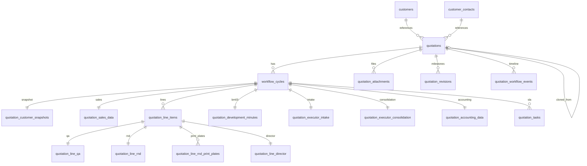

# Quotation domain — schema draft

**Status:** **Superseded by `../SCHEMA.md`** for migrations and implementation. Keep this file for document traceability; enum and Option A task rules match SCHEMA (Nov 2026).  
**Sources:** See `document-index.md`. Primary: Data Field Spec, Business Rules, Customer spec (quotation links), Workflow State Machine, SLA spec, Open Questions.

---

## 1. Product decisions (override doc OPEN / stack)

| Topic | Decision |
|-------|----------|
| **VER-002 Envers** | Doc requires Hibernate Envers. INLA-S uses **Neon Postgres + Lambda**. **No Envers.** Replace with: (1) `audit_events` + `audit.capture_row_change()` on all quotation tables; (2) INSERT-only **`quotation_revisions`** at Submit/Re-submit milestones (VER-006); (3) draft saves → one audit row per row UPDATE (VER-005). |
| **quotationCode (DF-OPEN-08, OQ-QUO-01)** | Format still OPEN in BA docs. INLA-S: **`BG-` + 6 zero-padded digits** via `quotation_code_seq` + `next_quotation_code()` (mirror `KH-######`). |
| **revisionId (SYS-11)** | `revision_number` int per quotation + `revision_code` text (e.g. `REV-03`) for UI (OQ-QUO-02). |
| **cycleNumber (SYS-06)** | `workflow_cycles.cycle_number` int ≥ 1, unique per quotation. |
| **Sales owner (QUO-002/003)** | `sales_owner_username text NOT NULL` — app sets from JWT; client must not set owner. |
| **Customer / contact (SAL-01/02)** | FK `customer_id` NOT NULL, `contact_id` NULL (individual rules in app). **Snapshot** row per cycle at Submit (customer spec: history unchanged when master edits). |
| **Line items (QUO-008)** | **`quotation_line_items` per cycle** (PRICE-FORMAT; migration `015`). SKU: `item_code`, `item_name`, `flute_type`, dimensions, `quantity`, Executor `unit_price`, optional `line_remark`. `quotation_sales_data` keeps one set per cycle of material, printing, load, and `dimension_type`, plus note and delivery fields. |
| **Per-line QA, R&D, director** | **`quotation_line_qa`**, **`quotation_line_rnd`**, **`quotation_line_director`** (`017`), 1:1 with each line. Cycle tables `quotation_qa_data`, `quotation_rnd_data`, `quotation_director_data` are dropped. Accounting stays one row per cycle. Director status rollup is an application rule (`../SCHEMA.md` §6), not a trigger. |
| **Workflow vs cycle** | `quotations.workflow_status` = current gate; `workflow_cycles` = each NEW / RE_SUBMIT run (VER §6.1). |
| **Hard delete** | No quotation hard delete in MVP. `quotations.customer_id` → **ON DELETE RESTRICT**. Enable CUS-012 / QUO reference checks. |
| **Money** | VND as **`numeric(18,2)`** (implemented in `010+`). |
| **VAT (ACC-02)** | Default **10** on accounting row; app-editable. |
| **OPEN field types** | `desired_delivery_time` → **text** (DF-OPEN-02). ~~`production_lead_time`~~ **removed (EXC-04 dropped)**. `financial_adjustment` → **text** (OQ-QUO-07). Catalog fields → **text** until master data. |
| **Authorization** | Not in DB (Role Permission Matrix → Lambda). |
| **Similar quotations (SIM-*)** | No ranking tables; query-time only (out of scope DB). |

---

## 2. ERD

**Denormalize `quotation_id`** on every child table listed above (including `workflow_cycles`) for audit triggers.

---

## 3. Enums

Create Postgres enums in migration `007_quotation_enums.sql` (names fixed until rename migration).

| Enum | Values | Source |
|------|--------|--------|
| `workflow_status_enum` | `draft`, `cancelled`, `executor_intake`, **`qa_rnd_review`** (parallel QA+R&D gate), `executor_consolidation`, `accounting_review`, `director_review`, `approved`, `rejected` — per Workflow State Machine §4. Separate **`task_type_enum`** values `qa_review` / `rnd_review` for the two tasks. |
| `business_outcome_enum` | `not_updated`, `sent_to_customer`, `won`, `lost` | SYS-04 |
| `cycle_type_enum` | `new`, `re_submit` | SYS-05 |
| `task_type_enum` | `executor_intake`, `qa_review`, `rnd_review`, `executor_consolidation`, `accounting_review`, `director_review` | Permission matrix §7 |
| `task_status_enum` | `pending`, `in_progress`, `completed` | QA-05, etc. |
| `dimension_type_enum` | `inner`, `outer` | SAL-14 (Lọt lòng / Phủ bì) |
| `sla_alert_state_enum` | `normal`, `warning`, `overdue` | SYS-12, SLA doc |
| `director_decision_enum` | `approved`, `rejected` | DIR-01 |
| `attachment_section_enum` | `sales`, `qa`, `rnd`, `executor_intake`, `executor_consolidation`, `accounting` | ATT-08/09 |
| `workflow_action_type_enum` | `submit`, `cancel`, `task_start`, `task_complete`, `approve`, `reject`, `outcome_update`, `resubmit_open`, `clone` | HIS-06 |

Use `snake_case` enum labels in Postgres; map to camelCase in API.

---

## 4. Tables

### 4.1 `quotations`

| Column | Type | Constraints | Spec ref |
|--------|------|-------------|----------|
| `id` | uuid | PK, default `gen_random_uuid()` | |
| `code` | text | NOT NULL, UNIQUE | SYS-01 |
| `sales_owner_username` | text | NOT NULL | SYS-02 |
| `customer_id` | uuid | NOT NULL, FK → `customers(id)` ON DELETE RESTRICT | SAL-01 |
| `contact_id` | uuid | NULL, FK → `customer_contacts(id)` ON DELETE RESTRICT | SAL-02 |
| `cloned_from_quotation_id` | uuid | NULL, FK → `quotations(id)` ON DELETE RESTRICT | SYS-10, CLN-009 |
| `workflow_status` | workflow_status_enum | NOT NULL, default `draft` | SYS-03 |
| `business_outcome` | business_outcome_enum | NOT NULL, default `not_updated` | SYS-04 |
| `current_cycle_id` | uuid | NULL, FK → `workflow_cycles(id)` | add FK after cycles table |
| `version` | integer | NOT NULL, default 1 | optimistic lock |
| `created_at` | timestamptz | NOT NULL, default `now()` | SYS-07 |
| `updated_at` | timestamptz | NOT NULL, default `now()` | SYS-09 |
| `created_by` | text | NULL | SYS-08 |
| `updated_by` | text | NULL | |
| `cancelled_at` | timestamptz | NULL | QUO-021/022 |
| `cancelled_by` | text | NULL | |

**Indexes:** UNIQUE `code`; `(sales_owner_username, updated_at DESC)`; `(customer_id, created_at DESC)`; `(workflow_status)`.

**Sequence:** `quotation_code_seq`; function `next_quotation_code()` → `BG-000001` style.

---

### 4.2 `workflow_cycles`

| Column | Type | Constraints |
|--------|------|-------------|
| `id` | uuid | PK |
| `quotation_id` | uuid | NOT NULL, FK RESTRICT |
| `cycle_number` | integer | NOT NULL, UNIQUE `(quotation_id, cycle_number)` |
| `cycle_type` | cycle_type_enum | NOT NULL |
| `resubmit_reason` | text | NULL — app required when `re_submit` (SAL-04, RES-005) |
| `submitted_at` | timestamptz | NULL |
| `submitted_by` | text | NULL |
| `ended_at` | timestamptz | NULL |
| `created_at` | timestamptz | NOT NULL, default `now()` |

QUO-019: first submit creates cycle type `new`. RES-007/008: re-submit creates new cycle type `re_submit`, sales editable while cycle in draft until submit.

---

### 4.3 `quotation_customer_snapshots`

One row per `workflow_cycle_id` (PK or UNIQUE on `workflow_cycle_id`). Filled at Submit. Columns (all NOT NULL where master is NOT NULL):

- `workflow_cycle_id`, `quotation_id`
- `customer_type`, `customer_code`, `customer_name`, `tax_id`, `phone`, `email`, `address_line`, `province`
- `contact_id` (uuid snapshot reference), `contact_full_name`, `contact_email`, `contact_phone`, `contact_job_title` (nullable fields as needed)
- `created_at`

No UPDATE in app after insert.

---

### 4.4 `quotation_sales_data`

One row per `workflow_cycle_id`. SKU fields live on **`quotation_line_items`**. This row keeps `sales_note`, `delivery_location`, `desired_delivery_time`, `additional_requirements`, and one set per cycle of `dimension_type`, `material`, `product_load_kg`, and printing fields.

---

### 4.4.1 `quotation_line_items`

| Column | Type | Notes |
|--------|------|-------|
| `id` | uuid PK | |
| `workflow_cycle_id`, `quotation_id` | uuid | |
| `line_number` | int | UNIQUE per cycle |
| `item_code`, `item_name`, `flute_type` | text | LIN-01…03 |
| `length_mm`, `width_mm`, `height_mm` | numeric | LIN-04…06 |
| `quantity` | int | LIN-08 |
| `unit_price`, `line_remark` | numeric / text | LIN-07 / LIN-09. Executor writes only `unit_price` on the line. |

`017` adds `UNIQUE (id, workflow_cycle_id, quotation_id)` so child rows can use a composite FK. Annex: `Annex_PRICE-FORMAT_LineItems_MVP.md`.

---

### 4.5 `quotation_line_qa`

One row per SKU. `line_item_id` is PK and FK → `quotation_line_items(id)` ON DELETE RESTRICT. Composite FK `(line_item_id, workflow_cycle_id, quotation_id)` → `quotation_line_items (id, workflow_cycle_id, quotation_id)` ON DELETE RESTRICT. Replaces `quotation_qa_data` (scalars and `qa_line_data`).

| Column | Type |
|--------|------|
| `line_item_id` | uuid PK/FK |
| `workflow_cycle_id`, `quotation_id` | uuid NOT NULL |
| `quality_assessment_result`, `quality_requirements`, `qa_note` | text NULL |
| `burst_standard`, `compression_standard`, `weight_limit_standard`, `kcg_standard` | text NULL — QA-09…12 |
| `kcg_qa_sx_proposal_1`, `kcg_qa_sx_proposal_2`, `kcg_qa_sx_proposal_3` | text NULL — QA-13…15 |
| `created_at`, `updated_at` | timestamptz NOT NULL default `now()` |

Index `(quotation_id)`. `touch_updated_at` on UPDATE. Task/SLA columns live on **`quotation_tasks` only** (Option A).

---

### 4.6 `quotation_line_rnd`

Same keys and timestamps as `quotation_line_qa`. Replaces `quotation_rnd_data` (scalars and `rnd_line_data`). Per-line R&D technical fields (`018`).

| Column | Type |
|--------|------|
| `printing_plate_cost`, `die_cost` | numeric(18,2) NOT NULL default 0 |
| `production_plan`, `rnd_note` | text NULL — RND-11 |
| `layout_code`, `die_code`, `layout_quote_code`, `die_quote_code` | text NULL |
| `flute_kind`, `creasing`, `sheet_size`, `flute_other` | text NULL |
| `print_other_notes` | text NULL |
| `finish_glue`, `finish_staple`, `finish_die_cut`, `film_lamination` | text NULL |
| `bundling_method`, `pallet_notes` | text NULL |

RND-01, RND-02, RND-05, RND-06, RND-11 (+ system RND-07…10 on tasks). **Removed:** `expected_plate_order_date`, `expected_die_order_date` (RND-03/04).

### 4.6.0.1 `quotation_line_rnd_print_plates`

Seven rows per line (`plate_no` 1–7). UNIQUE `(line_item_id, plate_no)`. Composite FK → `quotation_line_items`. Index `(quotation_id)`.

| Column | Type |
|--------|------|
| `id` | uuid PK |
| `line_item_id`, `workflow_cycle_id`, `quotation_id` | uuid NOT NULL |
| `plate_no` | int NOT NULL CHECK 1–7 |
| `color_system`, `formula_composition`, `quota`, `trame`, `anilox` | text NULL |
| `created_at`, `updated_at` | timestamptz |

---

### 4.6.1 `quotation_development_minutes` (BM03 việc B)

| Column | Type |
|--------|------|
| `workflow_cycle_id` | uuid PK/FK |
| `quotation_id` | uuid NOT NULL |
| `meeting_place`, `meeting_date` | text / date NULL |
| `payload` | jsonb NOT NULL default `{}` — meeting keys only: `participants`, `designNotes`, `sampleBoxNotes`, `uvCoating`, `shippingNotes`, `meetingConclusion` |
| `created_at`, `updated_at` | timestamptz |

Annex: `document/annex/Annex_BM03_Development_Minutes_MVP.md`. One row per cycle. Per-line R&D technical data and print plates live on **`quotation_line_rnd`** / **`quotation_line_rnd_print_plates`**. The BM03 quality-standard mirror reads **`quotation_line_qa`**, not a cycle-level QA row.

---

### 4.7 `quotation_executor_intake`

| Column | Type |
|--------|------|
| `intake_note` | text NULL | EXI-05 optional; stays on the cycle. Task/SLA on `quotation_tasks` |

---

### 4.8 `quotation_executor_consolidation`

| Column | Type |
|--------|------|
| `delivery_terms` | text NULL — EXC-05 |
| `consolidation_note` | text NULL — EXC-06 |

**Removed:** `unit_price_per_piece` (→ line `unit_price`), `production_lead_time` (EXC-04). Task/SLA on `quotation_tasks`. EXC-02–03 RO from R&D.

Do not duplicate R&D costs; app reads `quotation_line_rnd`.

---

### 4.9 `quotation_accounting_data`

| Column | Type |
|--------|------|
| `payment_terms` | text NULL |
| `vat_rate` | numeric default 10 |
| `financial_adjustment` | text NULL |
| `final_quotation_value` | numeric |
| `accounting_note` | text NULL |

One row per cycle. No per-line accounting table. `final_quotation_value` is not recalculated from line decisions. Task/SLA on `quotation_tasks`. ACC-01–10.

---

### 4.10 `quotation_line_director`

Same keys and timestamps as `quotation_line_qa`. Replaces `quotation_director_data`.

| Column | Type |
|--------|------|
| `director_decision` | director_decision_enum NULL until decided |
| `approval_note` | text NULL |
| `rejection_reason` | text NULL |
| `decision_at` | timestamptz NULL |

No CHECK that would fail a historical row with a decision and a null `rejection_reason`. The app requires a non-blank `rejection_reason` on new `rejected` lines. Task/SLA on `quotation_tasks`. DIR-01–07. `quotations.workflow_status` stays one status per quotation; the rollup in §6 is application-only.

---

### 4.11 `quotation_tasks`

| Column | Type |
|--------|------|
| `id` | uuid PK |
| `quotation_id`, `cycle_id` | uuid FK |
| `task_type` | task_type_enum |
| `task_status` | task_status_enum |
| `started_at`, `completed_at` | timestamptz |
| `sla_started_at`, `sla_deadline_at`, `sla_completed_at` | timestamptz |
| `sla_duration_hours` | numeric | snapshot (SLA-04, RES-011) |
| `sla_alert_state` | sla_alert_state_enum |

UNIQUE `(cycle_id, task_type)`.

---

### 4.12 `quotation_attachments`

| Column | Type | Notes |
|--------|------|-------|
| `id` | uuid PK | |
| `quotation_id`, `cycle_id` | uuid | |
| `section` | attachment_section_enum | ATT-09 |
| `file_name`, `file_extension`, `mime_type` | text | ATT-01–03 |
| `file_size_bytes` | bigint | ATT-04 |
| `storage_key` | text NOT NULL | OQ-ATT-01 |
| `uploaded_by`, `uploaded_by_role` | text | ATT-05–06 |
| `uploaded_at` | timestamptz | ATT-07 |
| `source_attachment_id` | uuid NULL | ATT-10, CLN-008 |
| `deleted_at` | timestamptz NULL | soft delete ATT-013 |

Index `(cycle_id, section, uploaded_by_role)`.

---

### 4.13 `quotation_revisions` (INSERT-only)

| Column | Type |
|--------|------|
| `id` | uuid PK |
| `quotation_id`, `cycle_id` | uuid |
| `revision_number` | int UNIQUE `(quotation_id, revision_number)` |
| `revision_code` | text |
| `snapshot_jsonb` | jsonb NOT NULL |
| `created_at`, `created_by` | |

Milestones: Submit, Re-submit submit, optional task completes (app policy).

---

### 4.14 `quotation_workflow_events` (append-only)

| Column | Type |
|--------|------|
| `id` | bigserial PK |
| `quotation_id`, `cycle_id` | uuid |
| `from_status` | workflow_status_enum NULL |
| `to_status` | workflow_status_enum NOT NULL |
| `action_type` | workflow_action_type_enum |
| `actor_username`, `actor_role` | text |
| `action_at` | timestamptz default `now()` |
| `action_note` | text NULL |

HIS-04–HIS-10. Prefer **single writer** (app inserts on transition) to avoid duplicate with status trigger — document choice in SCHEMA.md.

---

## 5. Audit (quotation extension)

See **`quotation-audit-checklist.md`**. Summary:

- Column `audit_events.quotation_id`
- Extend `audit.capture_row_change()` for quotation tables + semantic `action`
- `quotation_line_qa`, `quotation_line_rnd`, `quotation_line_director`: `entity_id` is `line_item_id::text`; `audit_events.quotation_id` comes from the row. Actions `quotation.line_qa.created` / `.updated` / `.deleted` and the same pattern for `quotation.line_rnd` and `quotation.line_director`
- `quotation_line_rnd_print_plates` (`018`): `entity_id` is `id::text`; `quotation.line_rnd_print_plate.created` / `.updated` / `.deleted`
- All writes via `runWithRequestContext`

### Envers mapping (VER)

| Doc | INLA-S |
|-----|--------|
| Per-transaction entity revision | `audit_events` row on each UPDATE/INSERT/DELETE |
| Historical API | Query `audit_events` + `quotation_revisions.snapshot_jsonb` |
| Submit / Re-submit marker | INSERT `quotation_revisions` + workflow event |

---

## 6. Business rules (application layer)

| IDs | Topic |
|-----|--------|
| QUO-016–022 | Draft, submit validation, cancel |
| QUO-004–005 | Sales scope vs global roles |
| ATT-001–015 | Limits, min attachments QA/RND/EXECUTOR consolidation |
| CLN-001–011 | Clone |
| RES-001–016 | Re-submit |
| QUO-046+ | Business outcome transitions after approved |
| CUS-012 | Customer with quotations — RESTRICT + app |
| Director submit | Every line of the current cycle has a non-null `director_decision`. All `approved` → `workflow_status = approved`. Any `rejected` → `workflow_status = rejected`. Approved lines on a rejected cycle stay stored. A new cycle gets new line ids and null decisions. Not a SQL trigger. `final_quotation_value` is not recalculated. |
| New rejected line | App requires a non-blank `rejection_reason`. No DB CHECK (historical rows may have a decision and a null reason). |
| Draft line children | Creating a line inserts empty QA, R&D, and director rows in the same transaction. Deleting a draft line deletes those three children first (`ON DELETE RESTRICT`). |

---

## 7. Migrations (applied after 006)

See **`../SCHEMA.md` §7** — files `007_quotation_enums.sql` … `017_line_qa_rnd_director.sql` in `../migrations/`. The next migration is `018`.

---

## 8. Out of scope (this DB pass)

- Similarity scoring persistence
- SLA admin configuration tables
- S3 / malware scan
- RLS
- Workflow state machine **logic** in SQL (only storage)

---

## 9. DB agent gate

1. **`../SCHEMA.md`** is authoritative (merged + Option A).  
2. Migrations **`007`–`017`** committed under `../migrations/`.  
3. Further changes: new migration **`018`** only.
